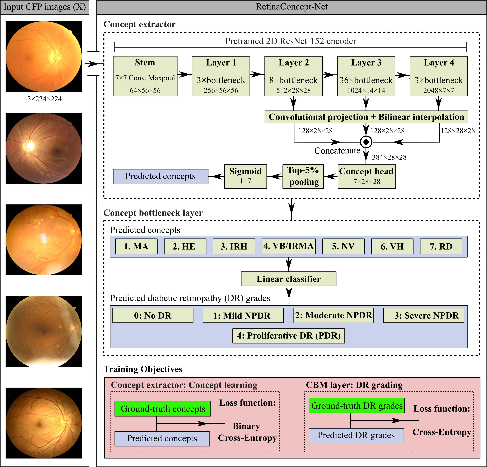

# RetinaConcept-Net

This repository contains the official implementation of **RetinaConcept-Net**, a concept-based deep learning framework for explainable diabetic retinopathy classification using colour fundus photographs, developed by **Ali Golbaf**. 

The proposed framework integrates a **ResNet-152** backbone with a **Concept Bottleneck Model (CBM)** to perform five-class diabetic retinopathy grading using seven retinal lesion concepts, providing interpretable evidence to support model predictions.
### 🔄 RetinaConcept-Net Workflow


### 🧠 Core ideas
* **Interpretable grading through a Concept Bottleneck Model**  
  RetinaConcept-Net introduces an explicit concept bottleneck between retinal image features and diabetic retinopathy (DR) severity predictions. Instead of directly predicting DR grades from deep image features, the model first predicts seven retinal lesion concepts, including microaneurysms, hard exudates, intraretinal haemorrhages, and neovascularisation. These concept predictions are then used to classify fundus images into five DR severity grades. By restricting the grading head to concept-level information, the framework provides a more transparent representation of the evidence contributing to its predictions.

* **Multi-scale retinal feature extraction and concept localisation**  
  RetinaConcept-Net employs a ResNet-152 backbone to extract spatial features from three intermediate network stages. These representations are projected into a shared feature space, aligned to a common spatial resolution, and fused to capture retinal abnormalities at different scales. A dedicated concept prediction head generates spatial activation maps for each lesion concept, enabling visual examination of the retinal regions contributing to concept predictions. These maps represent learned model evidence rather than clinically validated lesion segmentations.

* **Two-stage training with concept-guided DR classification**  
  RetinaConcept-Net adopts a two-stage training strategy to separate concept learning from disease severity classification. In the first stage, the concept prediction network is trained using lesion-level annotations, with top-k spatial pooling aggregating the strongest activation responses into image-level concept predictions. In the second stage, the concept extractor is frozen, and the grading head is trained to predict DR severity exclusively from the seven concept probabilities. This design allows concept recognition and grading performance to be evaluated separately, while a conventional ResNet-152 black-box model provides a baseline for comparison.


### 🗂️ Repository files

| File | Description |
| --- | --- |
| `main_code.py` | Original training/testing experiment, now driven by command-line arguments |
| `models.py` | Original black-box and CBM architecture |
| `train.py` | Original training and validation functions |
| `data_loader.py` | Original image preprocessing and augmentation|
| `utils.py` | Original annotation loading and grade/concept labels |
| `cli_config.py` | Argument definitions and validation |
| `reporting.py` | JSON output and per-class DR grading metrics |
| `evaluate.py` | Independent test-set predictions, reliability and error analysis |
| `explain.py` | Case-level CBM concept activation visualisations |
| `tests/` | Dataset-free unit tests |

### 🖼️ Retinal Image Dataset

The source dataset is described in:
Tang, Z. et al. (2026). *A multimodal retinal image dataset for diabetic retinopathy detection using foundation models*. Scientific Data, 13, 639. [DOI: 10.1038/s41597-026-07005-9](https://doi.org/10.1038/s41597-026-07005-9).

Data access: [MMRDR on Figshare](https://figshare.com/articles/dataset/MMRDR/29423747).

### ⚙️ Installation

Python 3.11 or 3.12 is recommended.

**1. Clone the repository**

```bash
git clone https://github.com/AliGolbaf/retinaconcept-net.git
cd retinaconcept-net
```

**2. Create a virtual environment**

```bash
python -m venv .venv
```

**3. Activate the environment**

On Windows (PowerShell):

```powershell
.\.venv\Scripts\Activate.ps1
```

On Linux or macOS:

```bash
source .venv/bin/activate
```

**4. Install dependencies**

First, install the appropriate CPU or CUDA version of PyTorch following the [official PyTorch installation guide](https://pytorch.org/get-started/locally/).

Then install the remaining dependencies:

```bash
python -m pip install -r requirements.txt
```

**5. Verify the installation**

```bash
python main_code.py --help
```

### 🚀 Running experiments

The training configuration, including the number of folds, batch size, learning rate, number of epochs, and random seed, can be specified through command-line arguments.

#### ⬛ Black-box model training

```bash
python main_code.py --mode Train_Black-box --data-root "PATH-TO-DATA" --output-dir outputs --num-folds 5 --batch-size 32 --epochs 100 --learning-rate 0.0001 --seed 42
```
Replace `PATH-TO-DATA` with the directory containing the MMRDR-CFP dataset (`FP.csv` and the `img/` folder).

The best checkpoint is saved for each fold:

```text
outputs/
└── blackbox_resnet152/
    ├── fold_1/best_model.pt
    ├── fold_2/best_model.pt
    ├── fold_3/best_model.pt
    ├── fold_4/best_model.pt
    └── fold_5/best_model.pt
```

#### 🔬 Concept Bottleneck Model Training

RetinaConcept-Net is trained using a two-stage strategy to separate retinal lesion concept learning from diabetic retinopathy (DR) severity classification.

**Stage 1: Concept Learning**

The model learns seven retinal lesion concepts using the annotated colour fundus photographs. The ResNet-152 backbone is initialised using the corresponding pretrained black-box model checkpoint, and the concept prediction network is optimised using binary cross-entropy loss.

**Stage 2: DR Grading**

Following concept learning, the concept extractor is frozen, and only the grading head is trained to classify images into five DR severity grades using the seven predicted concept probabilities.

**Run the training process**

```bash
python main_code.py --mode Train_CBM --data-root "PATH-TO-DATA" --output-dir outputs --num-folds 5 --batch-size 32 --concept-epochs 100 --grading-epochs 100 --learning-rate 0.0001 --seed 42
```

Replace `PATH-TO-DATA` with the directory containing the MMRDR-CFP dataset (`FP.csv` and the `img/` folder).

**Important:** The ResNet-152 black-box model must be trained first, as RetinaConcept-Net uses the corresponding black-box backbone weights to initialise the concept learning stage.

The best checkpoints from both training stages are saved separately for each fold:

```text
outputs/
└── cbm_resnet152/
    ├── fold_1/
    │   ├── best_concept_model.pt
    │   └── best_cbm_model.pt
    ├── fold_2/
    │   ├── best_concept_model.pt
    │   └── best_cbm_model.pt
    ├── fold_3/
    │   ├── best_concept_model.pt
    │   └── best_cbm_model.pt
    ├── fold_4/
    │   ├── best_concept_model.pt
    │   └── best_cbm_model.pt
    └── fold_5/
        ├── best_concept_model.pt
        └── best_cbm_model.pt
```

- `best_concept_model.pt`: Checkpoint selected using the lowest validation concept loss during Stage 1.
- `best_cbm_model.pt`: Final Concept Bottleneck Model checkpoint selected using the lowest validation grading loss during Stage 2.

#### Test evaluation

```bash
python main_code.py --mode Test_Black-box --data-root "D:/Datasets/MMRDR-CFP" --output-dir outputs
python main_code.py --mode Test_CBM --data-root "D:/Datasets/MMRDR-CFP" --output-dir outputs
```

## 6. Concept evidence visualisations

```bash
python explain.py --checkpoint outputs/cbm_resnet152/fold_1/best_cbm_model.pt --image "D:/Datasets/MMRDR-CFP/img/ts000001.jpg" --output-dir outputs/explanations --concept all
```

This writes one JSON prediction summary and seven PNGs comparing the original fundus image with each concept's evidence overlay. Adjust `--opacity`, `--threshold`, `--concept` or `--device` when required. The maps are low-resolution learned responses, not lesion annotations or causal explanations.

To meet the assessment's example-output requirement, generate examples locally using authorised images. Only share them if dataset permissions allow it. Real experimental results have not been invented or included in this repository.

No open-source licence has been selected; this requires the author's or PI's approval before publication.
